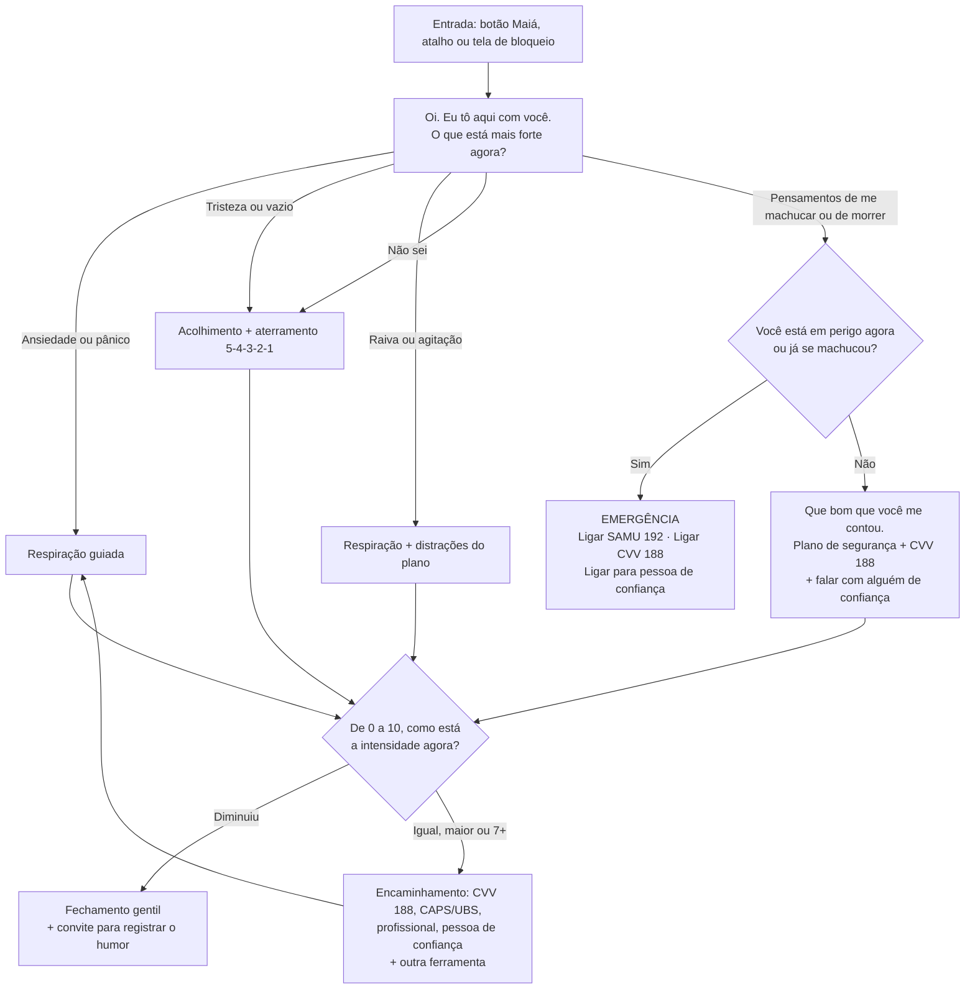

# Preparação — App de autocuidado em saúde mental com o Maiá

> **Codinome:** `remedios` · **Tecnologia:** Flutter (Android e iOS) · **Documento:** v1.0 — 18/11/2026
> **Status:** preparação (ainda sem código). **Sem IA nesta versão:** o Maiá funciona com um roteiro offline, com o motor já preparado para receber IA no futuro.

---

## Sumário

1. [Resumo em uma página](#1-resumo-em-uma-página)
2. [Princípios de produto](#2-princípios-de-produto)
3. [Escopo](#3-escopo)
4. [Para quem é e em que momentos](#4-para-quem-é-e-em-que-momentos)
5. [Mapa do app e navegação](#5-mapa-do-app-e-navegação)
6. [Módulos em detalhe](#6-módulos-em-detalhe)
7. [O Maiá](#7-o-maiá)
8. [Notificações](#8-notificações)
9. [Design system: fofo, mas utilizável](#9-design-system-fofo-mas-utilizável)
10. [Responsividade em várias telas](#10-responsividade-em-várias-telas)
11. [Acessibilidade](#11-acessibilidade)
12. [Arquitetura técnica](#12-arquitetura-técnica)
13. [Modelo de dados](#13-modelo-de-dados)
14. [Privacidade, LGPD e cuidados legais](#14-privacidade-lgpd-e-cuidados-legais)
15. [Qualidade e testes](#15-qualidade-e-testes)
16. [Plano de execução por fases](#16-plano-de-execução-por-fases)
17. [Riscos e como reduzir](#17-riscos-e-como-reduzir)
18. [Questões em aberto](#18-questões-em-aberto)
19. [Apêndice A — Roteiro inicial do Maiá](#apêndice-a--roteiro-inicial-do-maiá-exemplo)
20. [Apêndice B — Textos-modelo](#apêndice-b--textos-modelo)

---

## 1. Resumo em uma página

Um app **fofo, calmo e fácil de usar** para quem faz tratamento em saúde mental organizar o dia a dia e chegar mais preparado às consultas.

| Pilar | O que faz | Para que serve |
|---|---|---|
| **Humor → Calendário** | Registro diário em 2 toques (carinhas de 1 a 5) com detalhes opcionais. Vira um calendário colorido e um relatório para levar ao psiquiatra. | Mostrar ao médico como foi o período, sem depender da memória. |
| **Remédios** | Checklist do dia + notificações no celular com **Tomei** e **Adiar** direto na notificação. | Adesão ao tratamento. |
| **Hábitos** | Água (meta em ml), movimento (fez exercício?), alimentação (fez as refeições?). | Rotina básica de autocuidado. |
| **Maiá** | Companheiro para momentos de crise: acolhe, guia respiração e aterramento, abre o plano de segurança e encaminha para CVV 188, SAMU 192, CAPS e contatos de confiança. | Atravessar momentos difíceis e chegar até ajuda humana. |
| **Consulta** | Relatório em PDF + "modo consulta" na tela, com calendário de humor, adesão, efeitos colaterais, anotações e perguntas para o médico. | Consultas mais produtivas. |

**Decisões-chave**

- **Offline e local.** Sem conta, sem servidor, sem IA. Os dados ficam no celular.
- **Fofo, mas utilizável.** Ilustração e cor servem à clareza. Toda tela tem uma ação principal óbvia, alvos de toque de no mínimo 48 dp, e tudo funciona com a fonte do sistema em 200%.
- **Responsivo de 320 dp até tablets**, com layout adaptativo (barra inferior ↔ trilho lateral; uma ↔ duas colunas). Sobrevive sem quebrar até ~280 dp (tela externa de dobráveis).
- **Sem culpa.** Nada de "sequência quebrada", nada de calorias, nada de "você esqueceu".
- **Maiá determinístico.** Roteiro em JSON + motor de fluxo. Regras de segurança fixas, que continuam valendo quando a IA entrar.

---

## 2. Princípios de produto

1. **Dois toques para o essencial.** Registrar humor, marcar um remédio e somar água: cada um em até 2 toques a partir da tela Hoje.
2. **Gentileza em vez de cobrança.** O app comemora o que foi feito e nunca pune o que faltou. Dias sem registro aparecem neutros, nunca em vermelho.
3. **Ajuda sempre a um toque.** O Maiá fica no centro da barra de navegação. A faixa "CVV 188 · SAMU 192" aparece em todas as telas dele, inclusive na tela de bloqueio do app.
4. **Privacidade por padrão.** Dados no aparelho, notificações discretas, bloqueio opcional. Nada sai do celular sem uma ação explícita da pessoa (exportar, compartilhar, ligar).
5. **Previsível.** A ordem das abas e dos cartões não muda sozinha. Em crise, previsibilidade acalma.
6. **Acessível de verdade.** Leitor de tela, fonte grande, alto contraste, "reduzir movimento" e informação que nunca depende só de cor.
7. **O app organiza; quem trata é o profissional.** O app nunca sugere dose, diagnóstico ou mudança de tratamento.
8. **Modular.** A pessoa pode desligar módulos que não quer (ex.: alimentação, para quem tem histórico de transtorno alimentar).

---

## 3. Escopo

### 3.1 Prioridades (MoSCoW)

| Prioridade | Itens |
|---|---|
| **Must (MVP)** | Tela Hoje · registro de humor + calendário mensal + detalhe do dia · cadastro de remédios + checklist + notificações com ações · água · movimento · alimentação · Maiá roteirizado com respiração, aterramento, plano de segurança e tela de emergência · relatório PDF para consulta · tema claro/escuro · onboarding · responsividade e acessibilidade básicas · dados locais |
| **Should** | Bloqueio por PIN/biometria · banco de dados criptografado · backup criptografado (exportar/importar) · perguntas para a consulta · registro de efeitos colaterais · agenda de consultas · controle de estoque de remédio · atalho "Falar com o Maiá" no ícone do app · modo consulta na tela |
| **Could** | Visão "Ano em pixels" · animações Rive do Maiá · widget na tela inicial · sons calmos · resumo semanal · layout em duas colunas otimizado para dobráveis |
| **Won't (agora)** | IA no Maiá · conta/nuvem/sincronização · compartilhamento online com o médico · relógios (Wear OS/Apple Watch) · integração com Health Connect/HealthKit · outros idiomas |

### 3.2 O que o app **não** é

- Não é tratamento, não substitui psiquiatra, psicólogo ou serviço de emergência.
- Não diagnostica, não interpreta sintomas e não recomenda dose ou horário de medicação.
- Não é rede social: nada é publicado nem compartilhado automaticamente.

---

## 4. Para quem é e em que momentos

| Quem | Situação | O que precisa do app |
|---|---|---|
| **Lu, 27 anos** — trata depressão e ansiedade | Toma 2 remédios, esquece a dose da noite e chega na consulta sem lembrar como foi o mês. | Lembrete confiável, checklist rápido, calendário de humor e relatório. |
| **Rafa, 41 anos** — transtorno bipolar | O psiquiatra pede para acompanhar humor, energia e sono. | Campos opcionais de energia e sono, gráfico do período. |
| **Qualquer pessoa em crise** | 2h da manhã, ataque de pânico, mãos tremendo, quarto escuro. | Uma tela que funcione sem ler muito: poucas opções, botões grandes, tema escuro e caminho direto para ligar 188/192. |
| **Pessoa com pouca familiaridade com tecnologia** | Celular simples, tela pequena, fonte do sistema aumentada. | Layout que não quebra em 320 dp nem com fonte em 200%. |

---

## 5. Mapa do app e navegação

```
Abas (barra inferior no celular · trilho lateral em telas ≥ 600 dp)
├── Hoje
│   └── Configurações (ícone no topo)
├── Humor
│   ├── Calendário (Mês | Ano)
│   ├── Detalhe do dia
│   ├── Registrar / editar humor
│   └── Consulta → relatório PDF · modo consulta · perguntas · agenda de consultas
├── Maiá  (botão central destacado)
│   ├── Conversa roteirizada
│   ├── Ferramentas → respiração · aterramento 5-4-3-2-1 · frases · distrações
│   ├── Meu plano de segurança
│   └── Emergência → 188 · 192 · contatos de confiança · CAPS/UBS
├── Remédios
│   ├── Checklist de hoje
│   ├── Meus remédios → detalhe → editar
│   ├── Efeitos colaterais
│   └── Histórico de adesão
└── Hábitos
    ├── Água
    ├── Movimento
    └── Alimentação

Fora das abas: Onboarding · Bloqueio do app · Configurações
```

**Rotas (`go_router`, código em inglês):**

| Rota | Tela |
|---|---|
| `/today` | Hoje |
| `/mood`, `/mood/day/:date`, `/mood/entry?date=` | Calendário, detalhe do dia, registro |
| `/visit/report`, `/visit/mode`, `/visit/questions`, `/visit/appointments` | Consulta |
| `/maia`, `/maia/breathing`, `/maia/grounding`, `/maia/safety-plan`, `/maia/emergency` | Maiá |
| `/meds`, `/meds/new`, `/meds/:id`, `/meds/:id/edit`, `/meds/side-effects` | Remédios |
| `/habits/water`, `/habits/movement`, `/habits/meals` | Hábitos |
| `/settings/...`, `/onboarding`, `/lock` | Demais |

**Deep links internos:** a notificação de remédio abre `/meds?day=AAAA-MM-DD`; a de humor abre `/mood/entry`; o atalho do ícone abre `/maia`.

---

## 6. Módulos em detalhe

### 6.1 Hoje

A tela inicial: um resumo do dia com ações rápidas. **A ordem dos cartões é fixa.**

```
┌──────────────────────────────────────┐
│ Bom dia, Lu                     [⚙]  │
│ quarta, 18 de novembro               │
│                                      │
│  (Maiá)  Que bom te ver por aqui.    │
│                                      │
│ ┌ Como você está? ─────────────────┐ │
│ │  (1)   (2)   (3)   (4)   (5)     │ │
│ └──────────────────────────────────┘ │
│ ┌ Remédios de hoje ─────────── 1/3 ┐ │
│ │ [x] 08:00  Remédio A · 1 comp.   │ │
│ │ [ ] 14:00  Remédio B · 20 gotas  │ │
│ │ [ ] 22:00  Remédio C · 1 comp.   │ │
│ └──────────────────────────────────┘ │
│ ┌ Água ──────────┐ ┌ Movimento ────┐ │
│ │ ▓▓▓▓▓▓░░░ 1,2L │ │ Mexeu hoje?   │ │
│ │ meta 2L [+250] │ │ [Sim] [Ainda] │ │
│ └────────────────┘ └───────────────┘ │
│ ┌ Refeições ───────────────────────┐ │
│ │ [x]Café [x]Almoço [ ]Lanche [ ]J │ │
│ └──────────────────────────────────┘ │
├──────────────────────────────────────┤
│ Hoje  Humor  ( Maiá )  Remédios Háb. │
└──────────────────────────────────────┘
```

**Conteúdo**

1. Saudação pelo apelido + data por extenso + ícone de configurações.
2. Balão do Maiá com uma frase curta do banco de frases (muda conforme a hora e o contexto; nunca cobra).
3. **Como você está?** — 5 carinhas. Um toque salva o humor do dia e abre (opcionalmente) os detalhes. Se já registrou, mostra a carinha escolhida + "editar".
4. **Remédios de hoje** — doses do dia em ordem de horário. Tocar marca/desmarca "tomei" (com desfazer). Doses de horário passado sem registro aparecem como "sem registro", em tom neutro.
5. **Água** — garrafinha que enche + botão do copo padrão (ex.: +250 ml).
6. **Movimento** — "Mexeu o corpo hoje?" → Sim (abre detalhes opcionais) / Ainda não.
7. **Refeições** — chips por refeição; toque alterna entre os estados (ver 6.4.3).

**Regras**

- Módulos desligados nas configurações não aparecem.
- Todas as ações têm **desfazer** via snackbar por 5 segundos.
- Quando todas as doses do dia forem marcadas, o Maiá faz uma pequena comemoração (respeita "reduzir movimento").

**Pronto quando**

- [ ] Humor, remédio e água podem ser registrados em ≤ 2 toques cada.
- [ ] Sem overflow em 320 dp e com fonte em 200% (os cartões lado a lado viram coluna única).
- [ ] O leitor de tela anuncia cada cartão com título, estado e ação (ex.: "Remédio B, 14 horas, 20 gotas, não marcado. Toque duas vezes para marcar como tomado").

---

### 6.2 Humor e calendário

#### 6.2.1 Registro do humor

**Etapa 1 (obrigatória, 1 toque):** escala de 5 carinhas.

| Nível | Nome | Cor (claro) |
|---|---|---|
| 5 | Muito bem | Verde-menta `#6CCB8F` |
| 4 | Bem | Verde-limão `#B6DD6F` |
| 3 | Mais ou menos | Amarelo `#FFD966` |
| 2 | Mal | Pêssego `#FFAE6E` |
| 1 | Muito mal | Rosa `#F38BA0` |

**Etapa 2 (opcional, em uma folha que expande):**

| Campo | Tipo | Observação |
|---|---|---|
| Emoções | Chips múltiplos | Ansiedade, tristeza, irritação, medo, culpa, solidão, cansaço, vazio, calma, alegria, gratidão, esperança, motivação, confusão + "adicionar". Mostrar ~10 e "ver mais". |
| Ansiedade | 4 opções | Nenhuma · leve · moderada · forte |
| Energia | 5 opções | Muito baixa → muito alta (útil para acompanhar bipolaridade) |
| Sono | Horas (passo de 0,5) + qualidade | Qualidade: ruim · ok · boa |
| O que marcou o dia | Chips | Trabalho, estudos, família, relacionamento, amizades, saúde, dinheiro, sono ruim, álcool, outro |
| Anotação | Texto livre | Privada por padrão |
| Levar para a consulta | Interruptor | Só anotações marcadas entram no relatório |

**Regras**

- **Um registro principal por dia**, editável a qualquer momento. Dá para registrar dias passados pelo calendário.
- Os campos opcionais podem ser ligados ou desligados nas configurações (ex.: quem não quer sono).
- Depois de salvar, o Maiá reage de forma gentil e proporcional (humor 1–2: acolhimento + atalho discreto "Quer conversar com o Maiá?"; nunca "Anime-se!").
- Humor 1 por 3 dias seguidos → cartão gentil na tela Hoje: "Esses dias têm sido pesados. Que tal contar isso para alguém de confiança ou para seu psiquiatra?" com atalhos para o plano de segurança e a agenda. **Nunca é um alarme e não envia nada a ninguém.**

#### 6.2.2 Calendário

```
┌──────────────────────────────────────┐
│ Humor                  [Mês] [Ano]   │
│        <   Novembro 2026   >         │
│  D    S    T    Q    Q    S    S     │
│  1    2    3    4    5    6    7     │
│ (4)  (4)  (3)  (2)  (3)  (4)  (5)    │
│  8    9   10   11   12   13   14     │
│ (4)  (3)  (3)   ·   (2)  (1)  (2)    │
│ 15   16   17   18   19   20   21     │
│ (3)  (4)  (4)  (4)   ·    ·    ·     │
│ 22   23   24   25   26   27   28     │
│  ·    ·    ·    ·    ·    ·    ·     │
│ 29   30                              │
│ ┌ Novembro até agora ──────────────┐ │
│ │ 17 dias registrados · média 3,2  │ │
│ │ 5 ▓▓        4 ▓▓▓▓▓▓▓            │ │
│ │ 3 ▓▓▓▓▓     2 ▓▓▓   1 ▓          │ │
│ └──────────────────────────────────┘ │
│ [   Preparar para a consulta   ]     │
└──────────────────────────────────────┘
```

- Cada dia é uma célula arredondada **pintada com a cor do humor e com a carinha desenhada dentro** (nunca só cor). Dia sem registro: célula vazia com borda pontilhada, sem julgamento.
- Hoje tem um anel de destaque. Dias futuros ficam esmaecidos e não são clicáveis.
- Tocar num dia abre o **Detalhe do dia**.
- Gesto de arrastar troca o mês **e** há setas visíveis (o gesto nunca é o único caminho).
- **Visão Ano (Could):** "Ano em pixels", 12 mini-meses com as cores do humor.
- Abaixo do mês: resumo (dias registrados, média, distribuição em barras) e botão **Preparar para a consulta**.
- O calendário é um widget próprio (`MoodCalendar`), e não um pacote pronto, para ter controle total do visual e da responsividade (ver 10.3).

#### 6.2.3 Detalhe do dia

Uma página-diário que junta tudo do dia: humor e detalhes, remédios (tomados, pulados, sem registro), água, movimento, refeições, efeitos colaterais anotados e o uso do Maiá (se a pessoa tiver optado por registrar). Botões: **Editar humor** · **Adicionar anotação**.

**Pronto quando**

- [ ] O calendário de 6 semanas cabe sem rolagem horizontal de 280 dp a 600 dp.
- [ ] Em telas < 340 dp, a célula mostra número + cor + carinha simplificada (ícone menor); com fonte grande, o número não vaza da célula.
- [ ] Dias passados podem ser registrados e editados.

---

### 6.3 Remédios

#### 6.3.1 Cadastro

| Campo | Tipo | Detalhes |
|---|---|---|
| Nome | Texto | Obrigatório. Sem base de medicamentos no MVP (texto livre). |
| Dose | Número + unidade | Unidades: comprimido(s), cápsula(s), mg, ml, gotas, outra |
| Forma | Seleção com ícone | Comprimido, cápsula, gotas, líquido, injeção, adesivo, outro |
| Cor/ícone | Paleta de 8 cores pastel | Para reconhecer rápido na lista |
| Frequência | Seleção | Todo dia · dias da semana específicos · a cada X dias · quando necessário |
| Horários | Lista de horários | Um ou mais; cada horário pode ter dose própria |
| Início / término | Datas | Término opcional (ex.: tratamento de 30 dias) |
| Instruções | Texto curto | Ex.: "em jejum", "depois do almoço" |
| Estoque (Should) | Número + alerta | Desconta ao marcar "tomei"; avisa quando chegar no limite |
| Lembrete insistente | Interruptor | Se não marcar em 30 min, lembra de novo (uma vez) |

Aviso fixo no formulário, em texto pequeno e calmo: *"Cadastre exatamente como seu médico orientou. O app não sugere doses."*

#### 6.3.2 Checklist do dia

- Agrupado por período: **Madrugada · Manhã · Tarde · Noite**, e uma seção **Quando necessário** com o botão "Tomei agora" (registra horário).
- Cada linha: cor/ícone, horário, nome, dose, instrução curta e checkbox grande.
- Estados: **Tomei** (verde-menta + check), **Pulei** (opcional, via menu: "pulei esta dose"), **Sem registro** (neutro). Usar "sem registro", nunca "esquecida": a pessoa pode ter tomado e não marcado.
- Marcar uma dose atrasada pergunta: "Tomou no horário ou agora?" (para o relatório ser fiel).
- **Dose esquecida:** o app não orienta se deve ou não tomar atrasado. Mostra apenas: *"Em caso de dúvida sobre uma dose esquecida, fale com seu médico ou farmacêutico."*

#### 6.3.3 Efeitos colaterais (Should)

Botão "Anotar efeito" no detalhe do remédio e no detalhe do dia: texto + intensidade (leve, moderado, forte) + remédio relacionado (opcional). Entra no relatório por padrão (a pessoa pode desmarcar).

#### 6.3.4 Histórico de adesão

Por remédio: % de doses registradas como tomadas nos últimos 7 e 30 dias, em barra simples. Linguagem neutra: "Registradas como tomadas: 26 de 28".

**Pronto quando**

- [ ] Cadastro de um remédio diário com 2 horários em menos de 1 minuto.
- [ ] Notificação chega no horário com o app fechado, e **Tomei** funciona direto da notificação (ver seção 8).
- [ ] Editar ou excluir um remédio reagenda ou cancela todas as notificações dele.
- [ ] Remédio encerrado vai para "Arquivados" e o histórico continua no relatório.

---

### 6.4 Hábitos

#### 6.4.1 Água

- Garrafinha (ou plantinha regada) que enche com animação de onda.
- Botões de copo: **+150 · +250 · +500 ml** e "outro valor". Desfazer o último.
- Meta diária configurável (padrão 2.000 ml) com nota: *"Ajuste conforme a orientação de saúde que você recebeu."*
- Histórico da semana em barras.
- Lembretes opcionais em intervalos (ex.: a cada 2 h) apenas entre o horário de acordar e o de dormir.

#### 6.4.2 Movimento

- Pergunta central: **"Mexeu o corpo hoje?"** Qualquer movimento conta.
- Detalhes opcionais: tipo (caminhada, alongamento/yoga, academia, corrida, bicicleta, dança, esporte, tarefas ativas, outro), duração, intensidade (leve, moderada, intensa) e "como se sentiu depois" (carinhas).
- Vários registros por dia.
- Meta opcional semanal em **dias** (ex.: 3 dias por semana), nunca em calorias.

#### 6.4.3 Alimentação

- Refeições padrão: **Café da manhã · Almoço · Lanche · Jantar** (dá para adicionar "Ceia" ou "Lanche da manhã").
- Cada refeição tem 3 estados por toque: **Comi bem · Comi pouco · Pulei**, mais uma anotação opcional.
- **Sem calorias, sem peso, sem "comida boa ou ruim".** O objetivo é saber se a pessoa se alimentou (alguns remédios dependem disso e o psiquiatra costuma perguntar).
- O módulo pode ser desligado no onboarding e nas configurações.

**Pronto quando**

- [ ] Somar água em 1 toque a partir da tela Hoje.
- [ ] Nenhum texto, gráfico ou meta envolvendo peso ou calorias.

---

### 6.5 Maiá

Ver a [seção 7](#7-o-maiá), que é dedicada a ele.

---

### 6.6 Consulta: relatório, modo consulta, perguntas e agenda

#### 6.6.1 Relatório em PDF

**Gerar:** Humor → *Preparar para a consulta*, ou pelo lembrete da véspera da consulta.

**Período:** "desde a última consulta" (se houver agenda), últimos 30 dias (padrão) ou personalizado.

**A pessoa escolhe as seções incluídas** (todas vêm marcadas, exceto o uso do Maiá):

| Página | Conteúdo |
|---|---|
| 1 — Humor | Cabeçalho (apelido, período, data de geração) · calendário(s) do período com cor **e número do humor** em cada dia (funciona impresso em preto e branco) · legenda · linha do humor ao longo do tempo · resumo: dias registrados, média, distribuição, dias com ansiedade forte, média de sono e energia (se usados) |
| 2 — Remédios | Remédios atuais (nome, dose, horários, desde quando) · encerrados no período · adesão por remédio (tomadas, puladas, sem registro) · efeitos colaterais anotados |
| 3 — Rotina e anotações | Água (média diária) · dias com movimento · refeições puladas por semana · anotações marcadas "levar para a consulta" · **perguntas para a consulta** · uso do Maiá (opcional: nº de vezes, ferramentas usadas, intensidade antes/depois) |

- Rodapé: *"Registros feitos pela própria pessoa no app. Não é laudo nem documento clínico."* + numeração de páginas.
- Formato A4 retrato, fonte mínima de 10 pt, cores com padrões e números (impressão P&B).
- Compartilhar pelo menu nativo (WhatsApp, e-mail, imprimir, salvar). **Nunca enviado automaticamente.**

#### 6.6.2 Modo consulta (Should)

Tela cheia para mostrar o celular ao médico: calendário grande, resumo e lista de remédios, **sem anotações privadas**. Funciona em paisagem. Botão "Sair do modo consulta".

#### 6.6.3 Perguntas para a consulta (Should)

Lista simples para anotar dúvidas ao longo do mês ("Posso tomar o remédio B à noite?"). Marcar como respondida depois da consulta. As não respondidas entram no relatório.

#### 6.6.4 Agenda de consultas (Should)

Data/hora, profissional (psiquiatra, psicólogo, outro), local e lembrete (padrão: 1 dia antes, com o atalho "Gerar relatório").

---

### 6.7 Onboarding

No máximo 6 telas, todas puláveis exceto a primeira:

1. **Oi, eu sou o Maiá.** O que o app faz + aviso curto: "não substitui atendimento profissional; em emergência, ligue 192".
2. **Como posso te chamar?** Apelido (opcional).
3. **O que você quer acompanhar?** Interruptores: humor (fixo), remédios, água, movimento, alimentação.
4. **Lembretes.** Explicação simples **antes** de pedir a permissão de notificações (e de alarmes exatos no Android).
5. **Seu primeiro remédio** (opcional, ou "fazer depois").
6. **Pessoas de confiança** (opcional): adicionar 1 contato para o plano de segurança, ou "fazer depois com calma".

---

### 6.8 Configurações

| Grupo | Itens |
|---|---|
| Perfil | Apelido · horário de acordar e de dormir (usado nos lembretes) |
| Módulos | Ligar/desligar remédios, água, movimento, alimentação · campos opcionais do humor |
| Metas | Água (ml) · copo padrão · movimento (dias/semana) · refeições acompanhadas |
| Lembretes | Check-in de humor (horário) · água (intervalo) · lembrete insistente · tempo do "adiar" (5/10/15/30 min) · **notificações discretas** (padrão: ligado) · horário de silêncio · "Testar lembrete agora" · guia de otimização de bateria (Android) |
| Consultas | Profissionais (nome, telefone) · agenda |
| Maiá | Plano de segurança · contatos de confiança · registrar uso do Maiá no histórico (padrão: desligado) |
| Aparência | Tema (sistema/claro/escuro) · reduzir movimento · tamanho do texto (segue o sistema; ajuste fino opcional) |
| Privacidade | Bloqueio por PIN/biometria · exportar backup criptografado · importar backup · apagar todos os dados (confirmação dupla) |
| Sobre | Aviso legal · política de privacidade · créditos · versão |

---

## 7. O Maiá

### 7.1 Quem é

O Maiá é o mascote e o companheiro do app: **uma criaturinha redonda e macia, cor lavanda, com bochechas rosadas, olhos de pontinho e um brotinho de duas folhas na cabeça** (cuidado e crescimento). Ele aparece no app inteiro em pequenas doses e assume o centro em momentos de crise.

**Personalidade:** calmo, gentil, frases curtas, sem pressa, sem julgamento. Valida antes de sugerir. Não força positividade.

**O que o Maiá faz:**
- acolhe e valida;
- guia técnicas simples de regulação (respiração, aterramento);
- lembra a pessoa do próprio plano de segurança e das pessoas de confiança;
- encaminha para ajuda humana: CVV 188, SAMU 192, CAPS/UBS, profissional da pessoa.

**O que o Maiá nunca faz:** diagnosticar, dar orientação sobre remédios, prometer que "vai passar logo", minimizar ("não é nada"), descrever métodos de autolesão, guardar segredos de forma que impeça a busca de ajuda, ou se apresentar como terapeuta.

### 7.2 Pontos de entrada

| Entrada | Detalhe |
|---|---|
| Botão central da barra de navegação | Sempre visível, cor própria, rótulo "Maiá" |
| Atalho no ícone do app (Should) | Pressionar o ícone → "Falar com o Maiá" (`quick_actions`) |
| Tela de bloqueio do app | Botão "Preciso de ajuda agora" → emergência (188/192) e respiração **sem desbloquear** e sem expor dados |
| Depois de um humor 1 ou 2 | Convite discreto, nunca automático |

### 7.3 Fluxo de crise



- A intensidade (0–10) é perguntada **antes** da primeira ferramenta e **depois** dela.
- A pessoa pode **sair a qualquer momento** (botão "Sair" sempre visível, sem "tem certeza?").
- A tela de emergência pode ser acessada de qualquer ponto do fluxo pela faixa de ajuda.

```
┌──────────────────────────────────────┐
│ ←  Maiá                       Sair   │
│                                      │
│               .-"""-.                │
│              ( ^   ^ )               │
│               '-...-'                │
│                                      │
│  Oi. Eu tô aqui com você.            │
│  O que está mais forte agora?        │
│                                      │
│  [ Ansiedade ou pânico           ]   │
│  [ Tristeza ou vazio             ]   │
│  [ Raiva ou agitação             ]   │
│  [ Pensamentos de me machucar    ]   │
│  [ ou de morrer                  ]   │
│  [ Não sei, só preciso de ajuda  ]   │
│                                      │
├──────────────────────────────────────┤
│ Ajuda agora:  [CVV 188]  [SAMU 192]  │
└──────────────────────────────────────┘
```

**Visual do modo crise:** menos estímulo. Fundo liso (lavanda bem clara ou o tema escuro), sem cartões coloridos, sem comemorações, sem números de progresso. Texto grande (mínimo 18 sp), no máximo 5 opções por tela, botões com a largura toda.

### 7.4 Ferramentas

| Ferramenta | Como funciona |
|---|---|
| **Respirar junto** | O próprio Maiá infla (inspira) e desinfla (solta). Padrões: **Lenta 4-6** (padrão: inspira 4 s, solta 6 s) e **Caixa 4-4-4-4**. Duração 1, 2 ou 3 min. Texto "Inspira… / Segura… / Solta…" + vibração leve a cada troca de fase (dá para fazer de olhos fechados). Com "reduzir movimento": troca a animação de escala por contagem e mudança suave de opacidade. |
| **Aterramento 5-4-3-2-1** | Uma etapa por tela: 5 coisas que você vê, 4 que pode tocar, 3 que ouve, 2 que cheira, 1 que saboreia. Bolinhas para tocar e contar (digitar é opcional). |
| **Frases para agora** | Cartões deslizáveis com frases de acolhimento (banco revisado) + as frases que a própria pessoa escreveu no plano. |
| **Minhas distrações** | Lista vinda do plano de segurança ("tomar um banho", "ouvir minha playlist", "ligar para a Ana"). |
| **Minhas razões** | O que importa para a pessoa (texto no MVP; foto no futuro). |
| **Ligar para alguém** | Contatos de confiança com botão de ligar e de mensagem. |

> Ferramentas extras (ex.: técnicas de temperatura/água fria) só entram depois de validadas por profissional de saúde mental.

```
┌──────────────────────────────────────┐
│ ←  Respirar junto             Sair   │
│                                      │
│             .-"""""""-.              │
│            (   o   o   )             │
│             '-._____.-'              │
│                                      │
│              Inspira...              │
│                  3                   │
│                                      │
│     (Lenta 4-6)   Caixa 4-4-4-4      │
│       1 min   (2 min)   3 min        │
│                                      │
│        [ Pausar ]   [ Parar ]        │
├──────────────────────────────────────┤
│ Ajuda agora:  [CVV 188]  [SAMU 192]  │
└──────────────────────────────────────┘
```

### 7.5 Plano de segurança

Baseado no modelo de **Plano de Segurança de Stanley & Brown**, com a adição de "minhas razões". O app sugere preencher **com calma, de preferência junto com o psicólogo ou psiquiatra**, e nunca exige no meio de uma crise.

| Seção | Pergunta-guia |
|---|---|
| 1. Sinais de alerta | Que pensamentos, sentimentos ou situações mostram que uma crise pode estar chegando? |
| 2. O que eu posso fazer por conta própria | O que me acalma ou me distrai? |
| 3. Pessoas e lugares que me distraem | Com quem ou onde eu me sinto melhor? |
| 4. Pessoas a quem posso pedir ajuda | Nome + telefone (botão de ligar) |
| 5. Profissionais e serviços | Psiquiatra, psicólogo, CAPS + CVV 188 e SAMU 192 (já preenchidos) |
| 6. Deixar o ambiente mais seguro | O que posso afastar de mim em momentos difíceis? |
| 7. Minhas razões | O que importa para mim? |

### 7.6 Encaminhamento (Brasil)

Os recursos ficam num arquivo de configuração por país (`assets/crisis/resources_BR.json`), para ficar fácil revisar e, no futuro, adicionar outros países.

| Recurso | Contato | Quando usar | Ação no app |
|---|---|---|---|
| **SAMU** | 192 | Perigo agora, já se machucou, emergência médica | Ligar (`tel:192`) |
| **CVV — Centro de Valorização da Vida** | 188 | Apoio emocional e prevenção do suicídio, 24 h, ligação gratuita; também tem chat pelo site | Ligar (`tel:188`) · abrir site |
| **CAPS / UBS** | — | Atendimento em saúde mental pelo SUS | Abrir mapa com a busca "CAPS perto de mim" |
| **Profissional da pessoa** | Cadastrado | Acompanhamento | Ligar / mensagem |
| **Pessoas de confiança** | Cadastradas | Não ficar sem companhia | Ligar / mensagem |

> Antes de publicar, **revalidar números, horários e textos** desses serviços.

### 7.7 Regras de segurança inegociáveis

1. A faixa **"Ajuda agora: CVV 188 · SAMU 192"** aparece em **todas** as telas do Maiá.
2. A opção de risco ("pensamentos de me machucar ou de morrer") está **sempre no primeiro nível**, com texto claro e sem eufemismo.
3. Escolher a opção de risco mostra **imediatamente** os botões de ligar, antes de qualquer outra conversa.
4. Nenhum caminho termina sem oferecer encaminhamento quando a intensidade for ≥ 7 ou quando a opção de risco foi escolhida.
5. Ligar é sempre um toque: botões grandes, cor própria de ajuda, sem menus no caminho.
6. Conteúdo segue boas práticas de comunicação segura sobre suicídio (ex.: recomendações da OMS para comunicação sobre suicídio): sem detalhes de métodos, foco em esperança e em buscar ajuda.
7. **Todo o texto do Maiá é revisado por um profissional de saúde mental antes do lançamento.**
8. Um **teste automatizado valida o roteiro**: todos os nós alcançáveis, sem becos sem saída, e todo nó de risco tem as ações 192 e 188.
9. Por padrão, o conteúdo das conversas **não é salvo**. Se a pessoa optar, salva só um resumo (horário, caminho escolhido, ferramentas usadas, intensidade antes/depois, se ligou para algum serviço).

### 7.8 Como funciona sem IA

```
assets/maia/script_pt_BR.json   ← roteiro (nós, mensagens, opções, ações)
assets/maia/phrases_pt_BR.json  ← banco de frases por contexto (Hoje, pós-registro, comemoração…)
assets/crisis/resources_BR.json ← serviços de ajuda

lib/features/maia/engine/
  maia_engine.dart          ← interface (contrato)
  scripted_maia_engine.dart ← implementação do MVP: lê o JSON e navega pelos nós
  maia_safety_guard.dart    ← regras fixas (opção de risco, faixa de ajuda, encaminhamento)
```

**Tipos de nó do roteiro:**

| Tipo | Uso |
|---|---|
| `message` | 1 a 3 balões do Maiá + opções de resposta (botões) |
| `scale` | Pergunta de intensidade 0–10 |
| `tool` | Abre uma ferramenta (`breathing`, `grounding`, `phrases`, `distractions`, `reasons`, `contacts`) e volta para um nó |
| `action` | `call` (número), `open_url`, `open_maps`, `open_safety_plan` |
| `branch` | Decide o próximo nó por regra (ex.: `intensity >= 7`) |
| `end` | Fechamento + convite opcional para registrar o humor |

**Conversa em formato de chat:** balões do Maiá entram com pequeno atraso (300–600 ms) e indicador "digitando" (desligado com "reduzir movimento"). A pessoa responde **apenas por botões** no MVP. Não há campo de texto livre, para não parecer que alguém está lendo.

Um exemplo do roteiro está no [Apêndice A](#apêndice-a--roteiro-inicial-do-maiá-exemplo).

### 7.9 Preparado para IA no futuro

```dart
abstract interface class MaiaEngine {
  Future<MaiaTurn> start(MaiaContext context);
  Future<MaiaTurn> reply(MaiaInput input); // botão escolhido ou, no futuro, texto livre
}

// MVP: ScriptedMaiaEngine implements MaiaEngine
// Futuro: AiMaiaEngine implements MaiaEngine, sempre envolvido pelo MaiaSafetyGuard
```

- O `MaiaSafetyGuard` roda **antes e depois** de qualquer motor. Palavras ou sinais de risco forçam o nó de segurança, mesmo com IA.
- A interface (`MaiaTurn`: mensagens, opções, ferramenta sugerida, ação) já é a mesma que a IA vai usar. Trocar o motor não muda nenhuma tela.
- Antes de ligar IA: consentimento explícito para enviar dados a um servidor, revisão de privacidade (LGPD) e revisão regulatória (ver seção 14).

### 7.10 O Maiá fora da crise

- Balão na tela Hoje com frases do banco (bom dia, boa noite, depois de registrar, depois de beber água).
- Expressões: feliz, acolhendo, respirando, dormindo (à noite), comemorando, curioso.
- Ilustra todos os estados vazios ("Ainda não tem remédios aqui. Quer cadastrar o primeiro?").
- **O brotinho nunca murcha.** Constância pode ganhar uma florzinha, mas faltar nunca tira nada.

---

## 8. Notificações

### 8.1 Tipos

| Tipo | Quando | Texto discreto (padrão) | Texto detalhado (opcional) | Ações |
|---|---|---|---|---|
| Remédio | Horário cadastrado | "Hora do seu cuidado das 08:00 💜" | "Remédio A · 1 comprimido · em jejum" | **Tomei** · **Adiar** |
| Remédio (insistente) | +30 min sem registro | "O cuidado das 08:00 está sem registro." | "Remédio A ainda está sem registro." | **Tomei** · **Pulei** |
| Estoque | Estoque ≤ limite | "Um item do seu cuidado está acabando." | "Remédio A: restam 5 comprimidos." | — |
| Água | Intervalo, entre acordar e dormir | "Um golinho de água? 💧" | — | **+250 ml** |
| Humor | Horário diário escolhido | "Como foi seu dia? Leva 10 segundos." | — | Abre o registro |
| Consulta | 1 dia antes | "Você tem um compromisso amanhã às 14:00." | "Consulta com Dra. X amanhã às 14:00." | **Gerar relatório** |

- **Horário de silêncio:** água e humor não tocam no horário de dormir. Remédios **sempre** tocam (foram agendados pela pessoa).
- **Canais Android separados** (Remédios, Água, Humor, Consultas) para a pessoa ajustar som e vibração de cada um no sistema.
- Tocar na notificação abre a tela certa (deep link).

### 8.2 Permissões e plataformas

| Plataforma | Cuidados |
|---|---|
| **Android 13+** | Pedir `POST_NOTIFICATIONS` em tempo de execução, depois de explicar o porquê. |
| **Android 12+** | Alarmes exatos: `SCHEDULE_EXACT_ALARM`. A partir do Android 14, essa permissão **vem negada por padrão** em instalações novas: explicar e levar a pessoa à tela do sistema; se negar, usar agendamento inexato e avisar que pode atrasar alguns minutos. **Evitar `USE_EXACT_ALARM`** (restrito pela política do Google Play a apps de alarme/calendário). |
| **Android** | `RECEIVE_BOOT_COMPLETED` para reagendar depois de reiniciar. Seguir o README do `flutter_local_notifications` (receivers no `AndroidManifest`, desugaring). |
| **Android (fabricantes)** | Samsung, Xiaomi, Motorola e outros podem matar apps em segundo plano. Tela "Meus lembretes não chegam" com instruções por fabricante e atalho para as configurações de bateria. |
| **iOS** | Pedir permissão (alerta, som, badge). Ações via categorias de notificação. **Limite de 64 notificações locais pendentes por app.** |
| **Ambos** | O botão **Tomei** é tratado em segundo plano por um handler de nível superior (`@pragma('vm:entry-point')`), que abre o banco, grava a dose e cancela o lembrete insistente. Testar com o app **fechado**. |

### 8.3 Estratégia de agendamento

Um único serviço, `ReminderScheduler`, é dono de todas as notificações:

1. **Lembretes-base de remédios** (todo dia ou dias da semana): notificações **repetitivas** (diária ou semanal por dia da semana). Ocupam 1 vaga por horário e não "acabam" se a pessoa não abrir o app.
2. **Frequências irregulares** ("a cada X dias", com data de término): notificações avulsas numa **janela rolante** (ex.: próximos 7 dias), recalculada a cada abertura do app, a cada dose marcada e no boot.
3. **Lembretes insistentes:** avulsos, só para as próximas 24 h, cancelados quando a dose é marcada.
4. **Orçamento no iOS (máx. 60 de 64):** prioridade remédios > insistentes > consulta > humor > água. Se estourar, reduz primeiro os lembretes de água e avisa na tela de configurações.
5. **IDs determinísticos** (inteiros de 32 bits) por faixa: remédios `1_000_000+`, insistentes `2_000_000+`, água `3_000_000+`, humor `4_000_000+`, consultas `5_000_000+`. Isso permite cancelar e reagendar sem duplicar.
6. **Reagendamento completo** (cancelar tudo e agendar de novo) ao: criar/editar/excluir remédio, mudar configurações, trocar fuso horário, restaurar backup e abrir o app depois de 24 h.

**Caso conhecido:** com lembrete repetitivo, se a pessoa marcar "tomei" **antes** do horário, a notificação ainda aparece. Ao tocar nela, o app mostra "Já registrado ✓". Documentar e testar esse caso.

### 8.4 Confiabilidade

- Botão **"Testar lembrete agora"** nas configurações (dispara em 10 s).
- Ao abrir o app, conferir se as permissões continuam concedidas. Se alguma foi revogada, mostrar um cartão gentil na tela Hoje.
- Testar em aparelhos reais: pelo menos 1 Samsung, 1 Xiaomi/Redmi, 1 Motorola e 1 iPhone.

---

## 9. Design system: fofo, mas utilizável

### 9.1 Personalidade visual

**Aconchegante, macio, claro.** Pense em papelaria fofa organizada: cantos bem arredondados, tons pastel, ilustrações simples, muito respiro. **A fofura nunca atrapalha a leitura:** contraste alto no texto, hierarquia clara, uma ação principal por tela.

### 9.2 Cores

Todos os pares de texto foram verificados com a fórmula de contraste da WCAG 2.x (mínimo 4,5:1 para texto normal).

**Tema claro**

| Token | Hex | Uso | Contraste |
|---|---|---|---|
| `background` | `#FFF9F4` | Fundo creme | — |
| `surface` | `#FFFFFF` | Cartões | — |
| `surfaceSoft` | `#F6F1FF` | Balão do Maiá, cartões secundários | — |
| `outline` | `#E4DEEE` | Bordas decorativas (nunca a única indicação de estado) | — |
| `outlineStrong` | `#8E89A6` | Bordas de controles (checkbox vazio, campo de texto, célula sem registro) | 3,2:1 no fundo · 3,3:1 no branco |
| `text` | `#2D2A3E` | Texto principal | 13,3:1 no fundo |
| `textMuted` | `#6B6880` | Texto secundário | 5,1:1 no fundo · 5,4:1 no branco |
| `primary` | `#5F4FD8` | Botões, seleção, links | Branco sobre ela 5,8:1 · ela sobre o fundo 5,6:1 |
| `primaryContainer` / `onPrimaryContainer` | `#ECE8FF` / `#2E2366` | Chips selecionados, destaques | 11,3:1 |
| `water` / `waterContainer` / `onWaterContainer` | `#2B78C2` / `#DCEEFF` / `#12406B` | Água | Branco sobre `water` 4,6:1 · 9,0:1 |
| `mint` / `mintContainer` / `onMintContainer` | `#1F7A52` / `#DDF5EA` / `#0F4A30` | Movimento, "feito" | Branco sobre `mint` 5,3:1 · 9,0:1 |
| `peachContainer` / `onPeachContainer` | `#FFE8D6` / `#6B3410` | Alimentação | 8,4:1 |
| `help` | `#B8325F` | Botões de ligar/ajuda | Branco sobre ela 5,7:1 |

**Tema escuro** (cores dessaturadas para não ofuscar à noite)

| Token | Hex | Contraste |
|---|---|---|
| `background` | `#1B1926` | — |
| `surface` | `#252233` | — |
| `surfaceSoft` | `#2F2B40` | Texto principal sobre ela 12,2:1 |
| `text` | `#F4F1FA` | 15,5:1 no fundo |
| `textMuted` | `#B7B2C9` | 7,5:1 na superfície |
| `outlineStrong` | `#7A7594` | Bordas de controles: 3,5:1 na superfície |
| `primary` / `onPrimary` | `#B8ACFF` / `#1F1650` | 8,1:1 · `primary` sobre o fundo 8,6:1 |
| `primaryContainer` / `onPrimaryContainer` | `#3A2F7A` / `#ECE8FF` | 9,4:1 |
| `waterContainer` / `onWaterContainer` | `#183A5C` / `#DCEEFF` | 9,9:1 |
| `mintContainer` / `onMintContainer` | `#173F2E` / `#DDF5EA` | 10,3:1 |
| `peachContainer` / `onPeachContainer` | `#4A2C1A` / `#FFE8D6` | 10,7:1 |
| `help` / `onHelp` | `#F08AAB` / `#1B1926` | 7,4:1 |

### 9.3 Escala de humor

| Nível | Claro | Escuro | Texto sobre a cor | Contraste (claro / escuro) |
|---|---|---|---|---|
| 5 Muito bem | `#6CCB8F` | `#5DB57E` | `#2D2A3E` / `#1B1926` | 7,0 / 6,9 |
| 4 Bem | `#B6DD6F` | `#A3C963` | idem | 9,0 / 9,1 |
| 3 Mais ou menos | `#FFD966` | `#E8C55C` | idem | 10,2 / 10,4 |
| 2 Mal | `#FFAE6E` | `#E89A5E` | idem | 7,6 / 7,6 |
| 1 Muito mal | `#F38BA0` | `#E07A90` | idem | 6,0 / 6,1 |

- **Nunca só cor:** cada nível tem uma **carinha própria desenhada no estilo do Maiá** e um número. Isso garante leitura por daltônicos e no PDF em preto e branco.
- As carinhas são SVGs próprios (não emojis do sistema), para ficarem iguais no Android e no iOS.
- O nível 1 é rosa, não vermelho: o calendário não deve parecer um alarme.

### 9.4 Tipografia

- **Fonte:** **Poppins** (geométrica, amigável, com acentos completos para pt-BR). Os arquivos vão **empacotados no app** (`assets/fonts`, pesos 400, 500, 600 e 700), já que o app é offline. Na demonstração, pode vir pelo pacote `google_fonts`.
- A Poppins é larga e tem altura-x grande: por isso os títulos usam SemiBold (600) em vez de Bold/ExtraBold, e os tamanhos de título são um pouco menores do que seriam com outra fonte.
- Tamanhos em `sp`, sempre respeitando o `textScaler` do sistema:

| Estilo | Tamanho / peso | Uso |
|---|---|---|
| `display` | 28 / SemiBold 600 | Números grandes (água, intensidade) |
| `headline` | 22 / SemiBold 600 | Título de tela |
| `title` | 18 / SemiBold 600 | Título de cartão |
| `bodyLarge` | 18 / Regular 400 | Texto do Maiá, modo crise |
| `body` | 16 / Regular 400 | Texto padrão (**mínimo para conteúdo**) |
| `label` | 14 / Medium 500 | Botões, chips |
| `caption` | 13 / Regular 400 | Apoio. Nunca para informação essencial. |

### 9.5 Forma, espaço e elevação

- **Raios:** cartões 24 · botões 16 ou pílula · chips pílula · folhas inferiores 28 no topo · células do calendário 12.
- **Espaçamento (base 4):** 4 · 8 · 12 · 16 · 20 · 24 · 32 · 40. Margem lateral da página: 12 (compacto) · 16 (regular) · 24 (expandido).
- **Elevação:** sombras bem suaves e coloridas (ex.: `primary` a 8% de opacidade, desfoque 16, deslocamento y 4). No escuro, sem sombra: diferenciar por tom de superfície.
- **Alvos de toque:** mínimo 48 × 48 dp, com 8 dp entre alvos.

### 9.6 Ícones e ilustrações

- **Ícones:** Phosphor (`phosphor_flutter`), estilos *Regular* para navegação e *Duotone* para cartões. O traço arredondado suaviza a geometria da Poppins.
- **Ilustrações:** Maiá em SVG (`flutter_svg`) com 6 expressões no MVP. Animações ricas em Rive ficam para depois (Could).
- **Estados vazios:** sempre Maiá + uma frase + uma ação.

### 9.7 Movimento e háptica

- Durações curtas: 150–300 ms, curva `easeOutCubic`. Nada pisca nem treme.
- Microinterações: check com "pulinho" ao marcar remédio · onda na garrafinha de água · coraçõezinhos discretos ao completar o dia.
- **Háptica leve** em: marcar dose, somar água, trocar fase na respiração.
- **Reduzir movimento** (`MediaQuery.disableAnimations` + opção no app): troca animações por transições de opacidade e desliga confetes.

### 9.8 Componentes base

| Componente | Função |
|---|---|
| `AdaptiveScaffold` | Barra inferior (< 600 dp) ou trilho lateral (≥ 600 dp) + botão central do Maiá |
| `ResponsivePage` | Largura máxima do conteúdo, margens por classe de tela, rolagem segura |
| `CuteCard` | Cartão padrão (título, ícone, ação opcional) |
| `MoodFace` / `MoodPicker` | Carinha (nível, tamanho) e seletor de 5 carinhas |
| `MoodCalendar` / `MoodDayCell` | Calendário mensal responsivo |
| `DoseTile` | Linha do checklist de remédios |
| `WaterBottle` | Progresso de água animado |
| `ChipSelector` | Seleção única ou múltipla com quebra de linha (`Wrap`) |
| `BigButton` | Botão principal de largura total |
| `MaiaAvatar` / `MaiaBubble` | Maiá com expressão + balão de fala |
| `HelpBar` | Faixa "Ajuda agora: CVV 188 · SAMU 192" |
| `BreathingMaia` | Maiá que respira (animação controlada por padrão e duração) |
| `IntensityScale` | Escala 0–10 com botões grandes (não slider: mais fácil com as mãos tremendo) |
| `EmptyState` | Ilustração + texto + ação |

### 9.9 Voz e tom

| Faça | Evite |
|---|---|
| "Que bom que você registrou." | "Parabéns, sequência de 5 dias!" |
| "Tudo bem não estar bem." | "Pense positivo!" |
| "O cuidado das 8h está sem registro. Já tomou?" | "Você esqueceu seu remédio!" |
| "Vamos respirar juntos?" | "Calma!" |
| "Que bom que você me contou." | "Obrigado" (o Maiá evita flexão de gênero) |
| "Você não precisa passar por isso sem ajuda." | "Você não está sozinho(a)." (evitar "(a)"; preferir frases neutras) |

- Frases curtas, segunda pessoa ("você"), português do dia a dia ("tô" pode aparecer no Maiá; textos de interface usam "estou").
- **Linguagem neutra em gênero** em todo o app, tanto para a pessoa quanto para o Maiá.

---

## 10. Responsividade em várias telas

### 10.1 Classes de largura

| Classe | Largura lógica | Exemplos | Navegação |
|---|---|---|---|
| **Mínima** | < 320 dp | Tela externa de alguns dobráveis | Barra inferior só com ícones; conteúdo em coluna única |
| **Compacta** | 320–359 dp | Androids de entrada, iPhone SE (1ª geração) | Barra inferior com rótulo só no item ativo |
| **Regular** | 360–599 dp | A maioria dos celulares (360, 375, 390, 393, 412, 430 dp) | Barra inferior completa |
| **Expandida** | ≥ 600 dp | Dobráveis abertos, tablets, celular em paisagem largo | Trilho lateral + duas colunas |

```dart
enum WindowClass { minimal, compact, regular, expanded }

extension WindowClassX on BuildContext {
  WindowClass get windowClass {
    final w = MediaQuery.sizeOf(this).width;
    if (w < 320) return WindowClass.minimal;
    if (w < 360) return WindowClass.compact;
    if (w < 600) return WindowClass.regular;
    return WindowClass.expanded;
  }
}
```

### 10.2 Regras de layout

1. **Nada de altura fixa em caixas com texto.** Usar `Column`/`Flexible`/`Wrap` e deixar crescer na vertical.
2. **Tudo rola.** Toda tela é rolável (`CustomScrollView`/`ListView`); nenhuma depende de caber na altura.
3. **Proporções, não pixels:** tamanhos derivados de `LayoutBuilder` (ex.: célula do calendário = largura disponível ÷ 7). **Não usar `flutter_screenutil`** ou similares que escalam fonte por largura (atrapalha a acessibilidade).
4. **Largura máxima de leitura:** conteúdo de coluna única limitado a 560 dp e centralizado; layouts em duas colunas, até 1.040 dp.
5. **Dois lado a lado vira um embaixo do outro** quando a largura < 360 dp **ou** o `textScaler` > 1,3 (ex.: cartões Água/Movimento).
6. **`FittedBox` só para números e decoração**, nunca para frases.
7. **Folhas inferiores:** `isScrollControlled: true`, `useSafeArea: true`, `DraggableScrollableSheet` com altura máxima de 90%.
8. **Zona do polegar:** ações principais na metade de baixo da tela em celulares; botão do Maiá no centro da barra.

### 10.3 Comportamento por componente

| Componente | Compacta / mínima | Regular | Expandida |
|---|---|---|---|
| Navegação | Ícones; rótulo só no item ativo; Maiá central | 5 itens com rótulo; Maiá central elevado | `NavigationRail` à esquerda, Maiá no topo do trilho |
| Hoje | Cartões em coluna única | Água + Movimento lado a lado | Grade de 2 colunas |
| Calendário | Célula ≥ 36 dp: número + cor + carinha pequena; abaixo disso, carinha vira ponto e o número continua | Número + carinha | Calendário à esquerda + detalhe do dia à direita |
| Remédios | Lista; detalhe em tela própria | Lista; detalhe em tela própria | Lista + detalhe lado a lado |
| Seletor de humor | 5 carinhas de 44–48 dp; rótulos embaixo só do selecionado | Carinhas de 56 dp com rótulos | Igual ao regular, centralizado |
| Maiá | Botões de largura total | Botões de largura total | Coluna central de no máximo 560 dp |
| Relatório (pré-visualização) | Rolagem vertical das páginas | Idem | Páginas lado a lado |

Exemplo do layout expandido do Humor:

```
┌──────┬────────────────────────────┬───────────────────────┐
│ Hoje │  <   Novembro 2026   >     │  Quarta, 18/11        │
│ Humor│  D  S  T  Q  Q  S  S       │  Humor: 4 · Bem       │
│ Maiá │  [grade do mês]            │  Ansiedade: leve      │
│ Rem. │                            │  Remédios: 3 de 3     │
│ Háb. │  Resumo do mês             │  Água: 1,8 L          │
└──────┴────────────────────────────┴───────────────────────┘
```

### 10.4 Texto grande

- Respeitar o `textScaler` do sistema. **Testar em 1,0 · 1,3 · 1,5 · 2,0.**
- Não limitar a escala abaixo de 2,0 em conteúdo. Só elementos decorativos (ex.: número dentro da garrafinha) podem ter limite próprio.
- Com escala > 1,3: chips quebram em várias linhas, cartões lado a lado empilham, a barra inferior mostra só ícones com `tooltip`/`semanticLabel`.

### 10.5 Áreas seguras, teclado e orientação

- `SafeArea` em todas as telas: notch, Dynamic Island, barra de gestos.
- **Android 15+ é edge-to-edge por padrão** para apps com `targetSdk` 35: o fundo da barra inferior deve se estender por baixo da barra de gestos, com o conteúdo respeitando os *insets*.
- Formulários dentro de rolagem + `resizeToAvoidBottomInset`; o campo focado sempre visível acima do teclado.
- **Retrato é o principal, mas a paisagem não pode quebrar** (tudo rola). O modo consulta e o calendário aproveitam a paisagem.
- Dobráveis (Could): considerar `MediaQuery.displayFeatures` para não colocar conteúdo sobre a dobra no layout de duas colunas.

### 10.6 Matriz de testes

| Tamanho (dp) | Representa | Testes |
|---|---|---|
| 280 × 653 | Tela externa estreita de dobrável | Não quebra (sem overflow) |
| 320 × 568 | Celular bem pequeno | Golden + manual |
| 360 × 800 | Android comum | Golden + manual |
| 393 × 852 | iPhone/Pixel médio | Golden + manual |
| 430 × 932 | Celular grande | Golden |
| 852 × 393 | Paisagem | Golden |
| 800 × 1280 | Tablet / dobrável aberto | Golden |

Cada golden em **tema claro e escuro** e com **texto 1,0 e 2,0**. Durante o desenvolvimento, usar o `device_preview` (só em debug) para alternar tamanhos rapidamente.

---

## 11. Acessibilidade

- [ ] **Leitor de tela (TalkBack/VoiceOver):** `Semantics` com rótulo, valor e dica em todos os controles customizados (carinhas, células do calendário, garrafinha, escala 0–10). Ex.: célula do calendário → "18 de novembro, humor 4, bem. Toque duas vezes para ver o dia."
- [ ] **Ordem de foco** lógica; o foco vai para o título ao abrir cada tela.
- [ ] **Contraste** ≥ 4,5:1 em texto e ≥ 3:1 em ícones e bordas de controles (paleta da seção 9 já validada; bordas de controles usam `outlineStrong`, nunca `outline`).
- [ ] **Nunca só cor:** humor com carinha + número; estados de remédio com ícone + texto.
- [ ] **Alvos ≥ 48 dp**; nada depende só de gesto (deslizar sempre tem botão equivalente).
- [ ] **Fonte até 200%** sem cortar texto.
- [ ] **Reduzir movimento** respeitado (sistema + opção no app).
- [ ] **Linguagem simples:** frases curtas, sem jargão clínico.
- [ ] **Tempo:** nada some sozinho em menos de 5 s; a respiração pode ser pausada.
- [ ] **Teclado/switch access** funcionando nas telas principais.

---

## 12. Arquitetura técnica

### 12.1 Stack e pacotes

Usar a **versão estável mais recente do Flutter** no início do projeto (conferir com `flutter --version`) e as versões estáveis atuais de cada pacote no pub.dev.

| Área | Pacote | Por quê |
|---|---|---|
| Estado | `flutter_riverpod` (+ `riverpod_generator`, opcional) | Simples, testável, bom com streams do banco |
| Navegação | `go_router` | Rotas declarativas, `StatefulShellRoute` para as abas, deep links |
| Banco local | `drift` + `drift_flutter` | SQLite tipado, consultas por período (relatório), streams reativos, migrações |
| Criptografia do banco (Should) | `sqlcipher_flutter_libs` | Banco criptografado com drift |
| Segredos | `flutter_secure_storage` | Chave do banco e PIN (Keychain/Keystore) |
| Notificações | `flutter_local_notifications` + `timezone` + `flutter_timezone` | Agendamento local com fuso correto e ações |
| Permissões | `permission_handler` | Notificações, alarmes exatos, otimização de bateria |
| Biometria (Should) | `local_auth` | Bloqueio do app |
| PDF | `pdf` + `printing` | Gerar, pré-visualizar e imprimir o relatório |
| Compartilhar | `share_plus` | Menu nativo para enviar o PDF/backup |
| Gráficos | `fl_chart` | Linha do humor e barras de água/adesão no app |
| Links/ligações | `url_launcher` | `tel:188`, `tel:192`, mapas, site do CVV |
| Atalho no ícone (Should) | `quick_actions` | "Falar com o Maiá" |
| Ilustrações | `flutter_svg` | Maiá e carinhas |
| Ícones | `phosphor_flutter` | Estilo arredondado e duotone |
| Animação avançada (Could) | `rive` | Maiá animado com máquina de estados |
| Datas/idioma | `intl` + `flutter_localizations` | pt-BR, datas por extenso |
| Modelos | `freezed` + `json_serializable` | Modelos imutáveis e leitura do roteiro do Maiá |
| Backup (Should) | `cryptography` + `file_picker` + `path_provider` | Backup criptografado com senha |
| Dev | `device_preview`, `very_good_analysis` (ou `flutter_lints`) | Testar tamanhos; lints rigorosos |

**Plataformas mínimas sugeridas:** Android 8.0 (API 26)+, que é onde surgiram os canais de notificação e cobre a grande maioria dos aparelhos ativos. iOS: o mínimo exigido pela versão do Flutter usada.

**Desenvolvimento no Windows:** dá para desenvolver e testar Android por completo. **Compilar e testar no iPhone exige macOS/Xcode** (um Mac ou CI com runner macOS). Recomendação: Android primeiro, iOS em seguida.

### 12.2 Estrutura de pastas

```
remedios/
├── lib/
│   ├── main.dart
│   ├── app/
│   │   ├── app.dart                 # MaterialApp.router, temas, localização
│   │   ├── router.dart              # go_router + shell das abas
│   │   ├── theme/                   # tokens: colors, mood_palette, typography, spacing, theme
│   │   └── responsive/              # WindowClass, ResponsivePage, AdaptiveScaffold
│   ├── core/
│   │   ├── database/                # AppDatabase (drift), tabelas, DAOs, migrações
│   │   ├── notifications/           # ReminderScheduler, canais, handler em segundo plano
│   │   ├── security/                # bloqueio, chave do banco, backup
│   │   ├── utils/                   # datas (LocalDay), formatação
│   │   └── widgets/                 # componentes base da seção 9.8
│   ├── features/
│   │   ├── onboarding/
│   │   ├── today/
│   │   ├── mood/                    # data/ domain/ presentation/
│   │   ├── medications/
│   │   ├── habits/                  # water/ movement/ meals/
│   │   ├── maia/                    # engine/ tools/ safety_plan/ presentation/
│   │   ├── visit/                   # relatório PDF, modo consulta, perguntas, agenda
│   │   └── settings/
│   └── l10n/
│       └── app_pt.arb
├── assets/
│   ├── fonts/                       # Poppins
│   ├── images/maia/                 # SVGs do Maiá e carinhas
│   ├── maia/                        # script_pt_BR.json, phrases_pt_BR.json
│   └── crisis/                      # resources_BR.json
├── test/                            # unidade, widget, golden
└── integration_test/
```

**Convenções:** código, nomes de arquivos e rotas em inglês; todo texto visível em pt-BR via ARB (nada de texto fixo nos widgets).

### 12.3 Camadas e estado

- **`data`**: DAOs do drift e repositórios (expõem `Stream`s).
- **`domain`**: modelos e regras puras, sem Flutter, 100% testáveis: `AdherenceCalculator`, `MoodStats`, `ReminderPlanner` (calcula próximas ocorrências), `ReportBuilder` (monta os dados do relatório), `ScriptedMaiaEngine`.
- **`presentation`**: telas, widgets e providers/controllers do Riverpod.
- Pragmatismo: sem camadas extras se não houver necessidade (nada de "use case" para cada CRUD).

### 12.4 Datas e fuso

- Registros "do dia" (humor, refeições, doses) usam **`LocalDay`** (`AAAA-MM-DD` no fuso do aparelho). Instantes (`taken_at`, `logged_at`) são salvos em UTC.
- A dose das 22h marcada à 0h30 conta para o **dia agendado**, não para o dia em que foi marcada.
- Fuso do aparelho via `flutter_timezone`; se mudar, reagendar tudo.

### 12.5 Segurança dos dados

- Banco criptografado (SQLCipher) com chave aleatória de 256 bits guardada no `flutter_secure_storage`.
  - No iOS, configurar a acessibilidade da chave como "após o primeiro desbloqueio", para que a ação **Tomei** em segundo plano consiga abrir o banco.
- Bloqueio do app por PIN/biometria ao abrir e após X minutos em segundo plano. A tela de bloqueio mostra "Preciso de ajuda agora" (188/192 e respiração) sem desbloquear.
- Prévia na troca de apps (Android `FLAG_SECURE` opcional / iOS tela de privacidade) para não mostrar dados no seletor de apps quando o bloqueio estiver ativo.
- **Sem analytics, sem SDKs de terceiros que coletam dados** no MVP.

---

## 13. Modelo de dados

Tabelas do drift (`id` inteiro autoincremento; `created_at`/`updated_at` em UTC em todas).

**`mood_entries`**
| Coluna | Tipo | Notas |
|---|---|---|
| `day` | TEXT, único | `AAAA-MM-DD` |
| `mood` | INT 1–5 | obrigatório |
| `anxiety` | INT 0–3 | opcional |
| `energy` | INT 1–5 | opcional |
| `sleep_hours` | REAL | opcional |
| `sleep_quality` | INT 1–3 | opcional |
| `emotions` | TEXT (JSON) | chaves, ex.: `["anxiety","tired"]` |
| `tags` | TEXT (JSON) | o que marcou o dia |
| `note` | TEXT | privada por padrão |
| `share_with_doctor` | BOOL | padrão `false` |

**`medications`**
| Coluna | Tipo | Notas |
|---|---|---|
| `name` | TEXT | |
| `dose_amount` / `dose_unit` | REAL / TEXT | |
| `form` | TEXT | comprimido, cápsula, gotas… |
| `color` / `icon` | INT / TEXT | |
| `instructions` | TEXT | opcional |
| `schedule_type` | TEXT | `daily` · `weekdays` · `interval` · `as_needed` |
| `weekdays_mask` | INT | bits seg→dom (para `weekdays`) |
| `interval_days` | INT | para `interval` |
| `start_day` / `end_day` | TEXT | `end_day` opcional |
| `stock_qty` / `stock_alert_at` | REAL | opcionais |
| `insistent_reminder` | BOOL | |
| `archived_at` | DATETIME | nulo = ativo |

**`medication_times`**: `medication_id` (FK), `time` (`HH:mm`), `dose_amount` (opcional, sobrescreve).

**`medication_intakes`**
| Coluna | Tipo | Notas |
|---|---|---|
| `medication_id` | FK | |
| `medication_time_id` | FK, nulo | nulo = dose "quando necessário" |
| `scheduled_day` | TEXT | dia ao qual a dose pertence |
| `status` | TEXT | `taken` · `skipped` (sem linha = sem registro) |
| `taken_at` | DATETIME | horário real |
| `note` | TEXT | |
| Índice único | | (`medication_time_id`, `scheduled_day`) |

**`side_effects`**: `day`, `medication_id` (nulo), `description`, `intensity` (1–3), `share_with_doctor` (padrão `true`).

**`water_logs`**: `day`, `logged_at`, `amount_ml`.

**`movement_logs`**: `day`, `type`, `duration_min`, `intensity` (1–3), `feeling` (1–5), `note`.

**`meal_logs`**: `day`, `meal` (`breakfast` · `lunch` · `snack` · `dinner` · `supper` · `custom:<nome>`), `status` (`well` · `little` · `skipped`), `note`. Índice único (`day`, `meal`).

**`appointments`**: `starts_at`, `professional_name`, `kind`, `place`, `note`, `reminder_minutes_before`.

**`doctor_questions`**: `text`, `answered` (BOOL), `appointment_id` (nulo).

**`contacts`**: `name`, `phone`, `relation`, `kind` (`trusted` · `professional`).

**`safety_plan_items`**: `section` (`warning_signs` · `self_coping` · `distractions` · `people` · `professionals` · `safe_environment` · `reasons`), `text`, `contact_id` (nulo), `position`.

**`crisis_sessions`** (só se a pessoa optar): `started_at`, `ended_at`, `path`, `tools_used` (JSON), `intensity_before`, `intensity_after`, `called_service` (nulo).

**`settings`**: `key`, `value` (JSON). Inclui módulos ativos, metas, horários e preferências. Fica no banco para entrar no backup.

**Migrações:** versão do schema desde o dia 1, com testes de migração do drift.

---

## 14. Privacidade, LGPD e cuidados legais

- Dados de saúde são **dados pessoais sensíveis** pela LGPD (art. 5º, II; tratamento no art. 11). No MVP, tudo fica **apenas no aparelho**, o que reduz muito o risco, mas ainda exige:
  - **política de privacidade** clara (o que é guardado, onde, como apagar);
  - consentimento explícito e específico **antes** de qualquer envio de dados no futuro (nuvem, IA);
  - **exportar e apagar** os próprios dados (já previstos em Configurações).
- **Aviso no onboarding e em "Sobre":** *"Este app ajuda você a se organizar e não substitui atendimento profissional. Em emergência, ligue 192 (SAMU) ou 188 (CVV)."*
- **Software médico:** manter o app como ferramenta de **organização e bem-estar** (sem diagnóstico, sem recomendação de dose, sem interpretação clínica) reduz o risco de enquadramento como software regulado. **Revisar o enquadramento com quem entende de regulação antes de adicionar IA** ou qualquer função de interpretação.
- **Lojas:** Google Play e App Store têm exigências específicas para apps de saúde (declarações de dados, formulário de saúde no Play). Preencher com fidelidade: "nenhum dado coletado/compartilhado" enquanto for 100% local.
- **Menores de idade:** se o público incluir menores, a LGPD exige cuidados extras (art. 14). Definir o público (ver questões em aberto).

---

## 15. Qualidade e testes

| Tipo | O que cobre |
|---|---|
| **Unidade** | `ReminderPlanner` (diário, dias da semana, a cada X dias, data de término, virada de dia, troca de fuso) · `AdherenceCalculator` · `MoodStats` · `ReportBuilder` · orçamento de notificações do iOS · IDs determinísticos |
| **Roteiro do Maiá** | JSON válido · todos os nós alcançáveis · sem becos sem saída · todo nó de risco tem as ações 192 e 188 · todos os caminhos com intensidade ≥ 7 oferecem encaminhamento |
| **Widget** | Componentes base com texto 1,0 e 2,0, temas claro/escuro, semântica (rótulos do leitor de tela) |
| **Golden** | Telas principais na matriz da seção 10.6 |
| **Integração** | Onboarding → cadastrar remédio → notificação agendada (serviço simulado) → marcar "tomei" → aparece no calendário e no relatório |
| **Manual em aparelho** | Notificações com app fechado, depois de reiniciar, com economia de bateria (Samsung, Xiaomi, Motorola, iPhone) · ação Tomei pela notificação · TalkBack e VoiceOver no fluxo do Maiá |
| **Revisão clínica** | Profissional de saúde mental revisa todo o texto do Maiá, o plano de segurança e os recursos de ajuda |

**Definição de pronto (cada tela):** sem overflow na matriz de tamanhos · textos no ARB · semântica revisada · claro e escuro · estados vazio e de erro desenhados · testes passando · `flutter analyze` sem avisos.

**CI (sugestão):** GitHub Actions rodando `flutter analyze`, `flutter test` e goldens a cada push. Build iOS num runner macOS quando chegar a hora.

---

## 16. Plano de execução por fases

| Fase | Entregas | Pronto quando |
|---|---|---|
| **0 — Fundação** | `flutter create --org <seu.dominio> --platforms android,ios remedios` · lints · estrutura de pastas · tokens de tema (claro/escuro) · Poppins empacotada · `AdaptiveScaffold` com as 5 abas · `go_router` · drift configurado · i18n pt-BR · `device_preview` · CI | O app abre com as 5 abas vazias, alterna tema e não quebra em 280–800 dp nem com texto em 2,0 |
| **1 — Humor** | Registro (2 etapas) · calendário mensal · detalhe do dia · cartão de humor na tela Hoje · carinhas SVG | Registrar e editar humor de hoje e de dias passados; calendário correto em toda a matriz |
| **2 — Remédios** | Cadastro · checklist · `ReminderScheduler` · permissões · ações Tomei/Adiar · lembrete insistente · histórico de adesão | Lembretes chegam com o app fechado em aparelho real; Tomei pela notificação grava a dose |
| **3 — Hábitos** | Água · movimento · alimentação · cartões na tela Hoje · lembretes de água | Os três registráveis em ≤ 2 toques; módulos desligáveis |
| **4 — Maiá** | Motor roteirizado + roteiro v1 · respiração · aterramento · frases · plano de segurança · contatos · tela de emergência · faixa de ajuda · testes do roteiro | Todo o fluxo da seção 7.3 funciona offline; testes do roteiro passando; texto enviado para revisão clínica |
| **5 — Consulta** | Relatório PDF · seleção de período e seções · compartilhar · modo consulta · perguntas · agenda de consultas | PDF legível impresso em P&B; período "desde a última consulta" funcionando |
| **6 — Polimento e beta** | Onboarding · configurações completas · bloqueio · criptografia · backup · estados vazios com Maiá · goldens completos · auditoria de acessibilidade · beta fechado com poucas pessoas + revisão clínica aplicada | Checklist de acessibilidade (seção 11) completo; sem bugs bloqueantes no beta |

**Depois do MVP (backlog):** Ano em pixels · Maiá animado em Rive · widget na tela inicial · resumo semanal · sons calmos · IA no Maiá (com guard de segurança) · sincronização opcional na nuvem · relógios · outros países/idiomas.

---

## 17. Riscos e como reduzir

| Risco | Impacto | Como reduzir |
|---|---|---|
| Lembretes não chegam (economia de bateria, fabricantes, alarme exato negado) | Alto: perde a confiança no app | Permissão de alarme exato explicada · guia por fabricante · "Testar lembrete" · verificação de permissões ao abrir · testes em aparelhos reais |
| Limite de 64 notificações no iOS | Médio | Lembretes repetitivos + janela rolante + orçamento com prioridades (seção 8.3) |
| Texto do Maiá inadequado para alguém em crise | Muito alto | Revisão clínica obrigatória · comunicação segura · regras fixas · testes do roteiro · sem texto livre no MVP |
| Pessoa em risco sem conseguir ligar | Muito alto | Ligar sempre a um toque; 188 e 192 são gratuitos; contatos de confiança com ligação e mensagem |
| Perda dos dados (celular perdido, desinstalação) | Médio | Backup criptografado + lembrete mensal gentil para fazer backup |
| Gamificação gerar culpa | Médio | Sem sequências punitivas, linguagem da seção 9.9 |
| Registro de alimentação servir de gatilho para transtorno alimentar | Médio | Sem calorias/peso; módulo desligável no onboarding |
| Dados expostos na tela de bloqueio do celular | Médio | Notificações discretas por padrão |
| Desenvolver no Windows sem Mac | Médio | Android primeiro; iOS com Mac ou CI macOS |
| Enquadramento regulatório no futuro (IA) | Médio | Sem diagnóstico/dose; revisão antes de adicionar IA |

---

## 18. Questões em aberto

1. **Nome do app.** Usar o próprio "Maiá" como nome ou um nome separado? Confirmar também a grafia e o artigo ("o Maiá").
2. **Plataforma inicial.** Android primeiro (recomendado, porque o desenvolvimento é no Windows)?
3. **Visual do Maiá.** Quem desenha (ilustrador, você, gerador de imagem + vetorização)? Formato SVG no MVP, Rive depois?
4. **Revisão clínica.** Há um psicólogo ou psiquiatra disponível para revisar o roteiro do Maiá e o plano de segurança?
5. **Destino do app.** Lojas públicas, uso pessoal, portfólio ou projeto acadêmico? Isso muda o peso de política de privacidade, formulários das lojas e LGPD.
6. **Público.** Só adultos? Menores exigem cuidados extras.
7. **Campos do humor.** Manter sono, energia e ansiedade como opcionais (proposta) ou simplificar ainda mais?
8. **Criptografia e bloqueio no MVP** ou na fase de polimento? (Proposta: fase 6, já com o banco preparado desde o início.)

---

## Apêndice A — Roteiro inicial do Maiá (exemplo)

Formato do arquivo `assets/maia/script_pt_BR.json` (trecho, **texto ainda a ser revisado clinicamente**):

```json
{
  "version": 1,
  "locale": "pt_BR",
  "start": "opening",
  "nodes": {
    "opening": {
      "type": "message",
      "maia": "calm",
      "messages": ["Oi. Eu tô aqui com você.", "O que está mais forte agora?"],
      "options": [
        { "label": "Ansiedade ou pânico", "next": "intensity_before", "set": { "path": "anxiety" } },
        { "label": "Tristeza ou vazio", "next": "intensity_before", "set": { "path": "sadness" } },
        { "label": "Raiva ou agitação", "next": "intensity_before", "set": { "path": "anger" } },
        { "label": "Pensamentos de me machucar ou de morrer", "next": "risk_check", "safety": true },
        { "label": "Não sei, só preciso de ajuda", "next": "intensity_before", "set": { "path": "unknown" } }
      ]
    },
    "risk_check": {
      "type": "message",
      "maia": "caring",
      "messages": [
        "Que bom que você me contou. Você não precisa passar por isso sem ajuda.",
        "Você está em perigo agora ou já se machucou?"
      ],
      "actions": [
        { "type": "call", "number": "192", "label": "Ligar para o SAMU (192)" },
        { "type": "call", "number": "188", "label": "Ligar para o CVV (188)" }
      ],
      "options": [
        { "label": "Sim", "next": "emergency" },
        { "label": "Não", "next": "risk_safe" }
      ]
    },
    "emergency": {
      "type": "action",
      "screen": "emergency",
      "messages": ["Vamos pedir ajuda agora. Toque para ligar."],
      "actions": [
        { "type": "call", "number": "192", "label": "Ligar para o SAMU (192)" },
        { "type": "call", "number": "188", "label": "Ligar para o CVV (188)" },
        { "type": "call_trusted_contact", "label": "Ligar para alguém de confiança" }
      ],
      "options": [{ "label": "Estou em um lugar seguro agora", "next": "risk_safe" }]
    },
    "risk_safe": {
      "type": "message",
      "maia": "caring",
      "messages": [
        "Fico feliz que você esteja em segurança neste momento.",
        "O CVV atende 24 horas pelo 188, de graça, se quiser conversar com alguém agora."
      ],
      "actions": [{ "type": "call", "number": "188", "label": "Ligar para o CVV (188)" }],
      "options": [
        { "label": "Abrir meu plano de segurança", "next": "safety_plan" },
        { "label": "Respirar junto com o Maiá", "next": "intensity_before" },
        { "label": "Ligar para alguém de confiança", "next": "trusted_contacts" }
      ]
    },
    "intensity_before": {
      "type": "scale",
      "messages": ["De 0 a 10, quão forte está isso agora?"],
      "store": "intensity_before",
      "next": "route_tool"
    },
    "route_tool": {
      "type": "branch",
      "rules": [
        { "if": "path == 'anxiety' || path == 'anger'", "next": "breathing" },
        { "else": true, "next": "grounding" }
      ]
    },
    "breathing": {
      "type": "tool",
      "tool": "breathing",
      "params": { "pattern": "4-6", "minutes": 2 },
      "next": "intensity_after"
    },
    "grounding": {
      "type": "tool",
      "tool": "grounding",
      "next": "intensity_after"
    },
    "intensity_after": {
      "type": "scale",
      "messages": ["E agora, de 0 a 10?"],
      "store": "intensity_after",
      "next": "check_progress"
    },
    "check_progress": {
      "type": "branch",
      "rules": [
        { "if": "intensity_after >= 7 || intensity_after >= intensity_before", "next": "referral" },
        { "else": true, "next": "closing" }
      ]
    },
    "referral": {
      "type": "message",
      "maia": "caring",
      "messages": [
        "Tá tudo bem se ainda estiver difícil. Às vezes a gente precisa de mais gente junto.",
        "Quer chamar alguém?"
      ],
      "actions": [
        { "type": "call", "number": "188", "label": "Ligar para o CVV (188)" },
        { "type": "open_maps", "query": "CAPS perto de mim", "label": "Encontrar um CAPS perto de mim" },
        { "type": "call_trusted_contact", "label": "Ligar para alguém de confiança" }
      ],
      "options": [
        { "label": "Tentar outra ferramenta", "next": "route_tool_alt" },
        { "label": "Abrir meu plano de segurança", "next": "safety_plan" }
      ]
    },
    "closing": {
      "type": "end",
      "maia": "happy",
      "messages": ["Você fez algo importante por você agora.", "Quer registrar como está se sentindo?"],
      "options": [
        { "label": "Registrar humor", "action": "open_mood_entry" },
        { "label": "Agora não", "action": "exit" }
      ]
    }
  }
}
```

> Nós `safety_plan`, `trusted_contacts` e `route_tool_alt` omitidos no exemplo. O `MaiaSafetyGuard` adiciona a faixa de ajuda em todos os nós, independentemente do JSON.

---

## Apêndice B — Textos-modelo

**Balões do Maiá na tela Hoje**
- Manhã: "Bom dia. Um passo de cada vez hoje, tá?"
- Tarde: "Já tomou um pouco de água? 💧"
- Noite: "Como foi o dia? Pode ser só uma carinha."
- Depois de registrar humor 4–5: "Que bom! Guarda esse momento."
- Depois de registrar humor 1–2: "Que bom que você contou como está. Se quiser, eu tô aqui."
- Todas as doses do dia marcadas: "Cuidado em dia. Você tá cuidando de você 💜"
- Voltou depois de dias sem abrir: "Que bom te ver de novo." (**nunca** "Você sumiu!")

**Estados vazios**
- Remédios: "Ainda não tem remédios aqui. Quer cadastrar o primeiro?"
- Calendário: "Seu calendário vai ganhando cor conforme você registra. Sem pressa."
- Plano de segurança: "Esse plano é seu. Dá para preencher aos poucos, de preferência num momento tranquilo ou junto com quem cuida de você."

**Permissão de notificações (antes do pedido do sistema)**
> "Para te lembrar dos remédios na hora certa, preciso poder enviar notificações. Elas aparecem de forma discreta, sem mostrar o nome do remédio, a não ser que você prefira."

**Aviso legal curto**
> "Este app ajuda você a se organizar e não substitui atendimento profissional. Em emergência, ligue 192 (SAMU). Para conversar com alguém agora, ligue 188 (CVV), 24 horas e gratuito."
